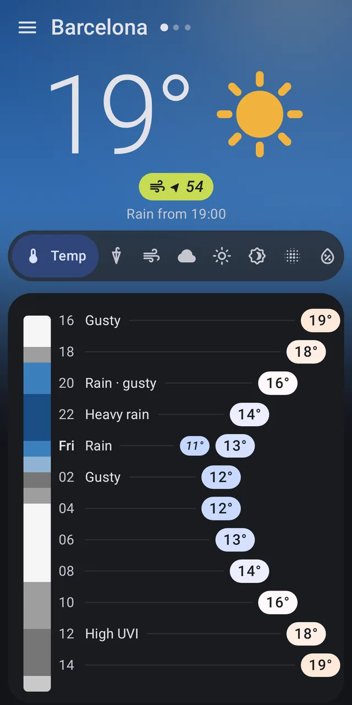
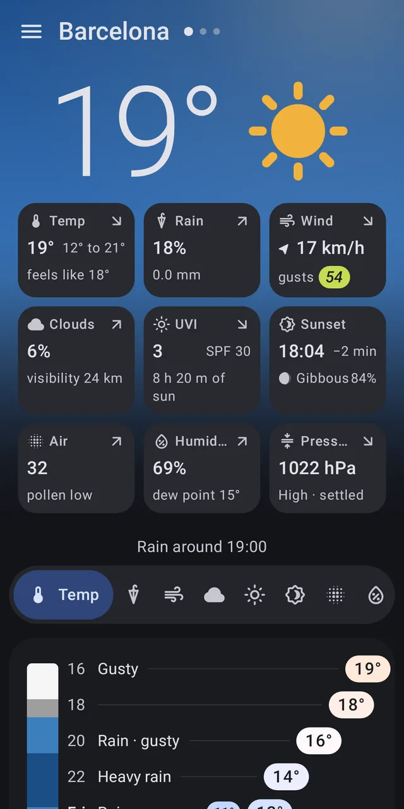
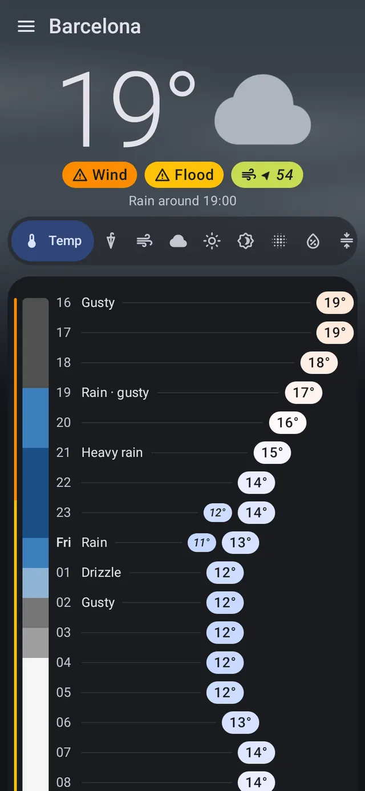
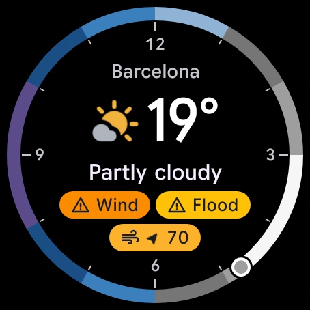
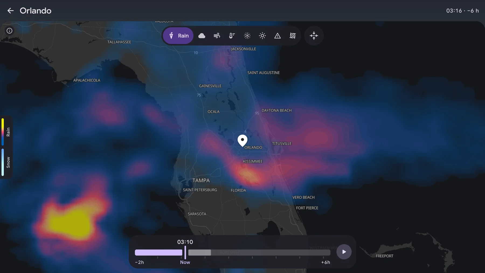

<h1 align="center">Skyline</h1>

The sky, hour by hour. A free weather app for Android phones, tablets, and watches, with no ads.

  

  <a href="https://skyline.arrufat.io/app/">Web app</a> ·
  <a href="https://skyline.arrufat.io/">Website</a> ·
  <a href="https://skyline.arrufat.io/faq.html">Questions</a> ·
  <a href="https://skyline.arrufat.io/privacy.html">Privacy</a>

  
  
  
  

  

## What it does

- Shows the next hours on one graph: temperature, rain, wind, clouds, UV, air quality, and the sun and moon.
- Shows the rain on a map, two hours back and six ahead, with wind, temperature, air, and storm layers.
- Shows official warnings from the weather service of the country you're in, and tells you when one starts.
- Tells you when rain is about to start or stop.
- Has home screen widgets, a watch app with a tile, and a page you can open in any browser.
- Looks up any day back to 1940.

Forecasts come from [Open-Meteo](https://open-meteo.com). Skyline has no account and no server of its own, so your places stay on your phone.

## Report a problem or ask for something

[Open an issue](https://github.com/arrufat/skyline/issues/new/choose). Issues are public, so don't post anything private there. For that, write to skyline@arrufat.io.

The app's code isn't public, so this repository takes issues but not pull requests. It also holds the website.
